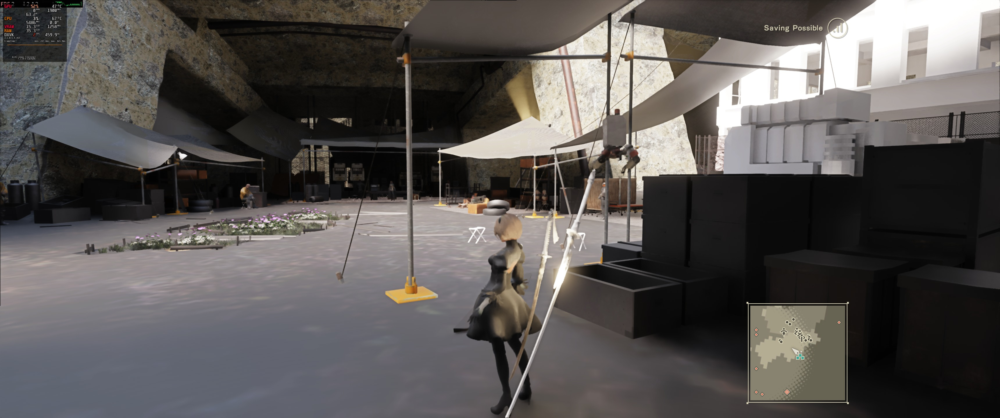

# 2026-10-29 — first live path-traced frame with the game's own HUD

`live-rtx-hud-2b.jpg` (3440×1440, 23:32): the running game, every frame's draws rebuilt into RTX Remix and
path-traced, with NieR's own HUD ("Saving Possible", minimap) drawn on top by the game itself. Build
`d3d11.dll` `065432e4…f8467e`, PortalRTX's Remix runtime, Proton GE 11-7, desktop RTX GPU.

What it shows working: 2B CPU-skinned without stretching, captured sun direction, sky dome fill, local lights,
alpha-tested foliage, native HUD compositing. What is still wrong: materials are albedo-only (clay look), the
buildings on the right are blown out, and it runs at **1–4 fps** (see below).

## The fixes behind it (each verified before it went in)

| Image | What it proves |
| --- | --- |
| `laptop-skinning-gpu-vs-cpu.png` | Same captured 2B mesh on the laptop's Remix runtime: API GPU skinning (broken, weight stride bug in the runtime) vs our CPU skinning (clean). Display exposure ×8 on both. |
| `laptop-sun-before-after.png` | Placeholder sun vs the game's own sun read from the scene pixel shader's constants. |
| `laptop-sky-dome-before-after.png` | No dome light vs HDR dome light after fixing the DDS header (`DDPF_FOURCC`) that crashed the runtime. |
| `laptop-sky-fill-0.5-vs-2.png` | Sky fill strength 0.5 vs 2.0; 2.0 is what the live build uses. |
| `live-hud-bug-flat-colour-half.png`, `live-hud-bug-recording-sheet.png` | First live HUD test: HUD correct, world one flickering colour. Cause: the replay pixel shader's inputs were misaligned with the vertex shader's outputs, which DXVK links by register; fixed and gated (`test_hud_replay_linkage.py`). |

## Performance, from `live-session-remix.log`

Second run (23:29–23:33), 300-frame window ending 23:32:16:

| | |
| --- | --- |
| fps | 3.6 (the user saw ~1 fps at times) |
| ms/frame | readback 152, other 125, present 1, copy 0 |
| draws / instances | 1296 / 1429 |
| meshes resident / built / evicted | 1980 / 22223 / 19717 |
| mesh bytes | 537 MB (512 MB budget) |
| textures / lights / sky | 240 / 26 / 7 |

The GPU is mostly idle: each readback stalls the CPU until the GPU drains its queue, and the mesh cache thrashes
(pose-specific skinned meshes). That is the next performance target, not the GPU.

`live-session-remix.log` is the `remix:` lines of the game log for both runs that night (window enumeration removed).
