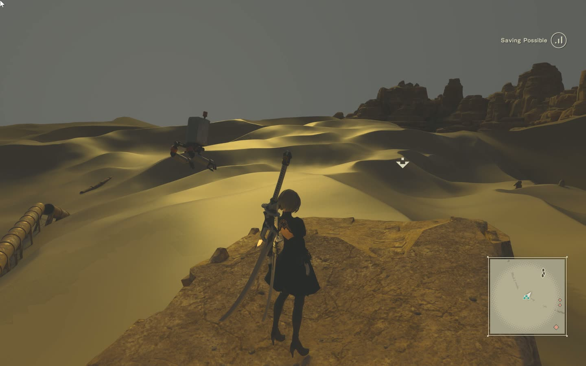
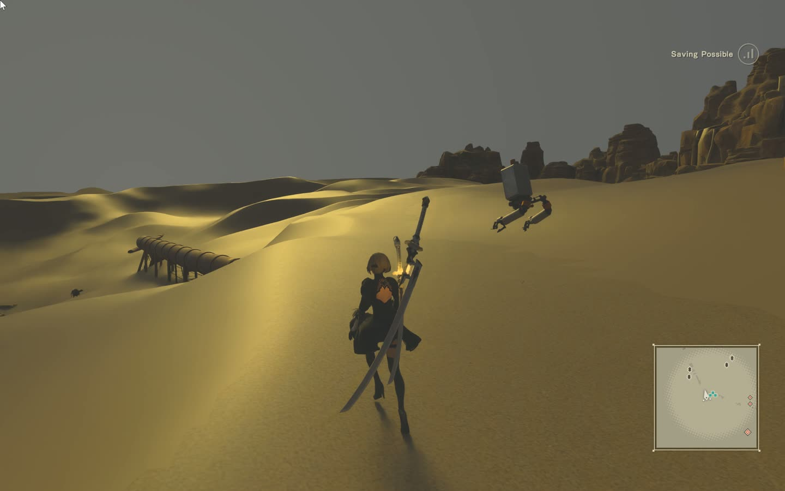

# 2026-11-14 — evidence images

## On the laptop (RTX Spark N1X), played by hand

Stills from the user's 87 s recording (`NieR Automata 2026.11.14 - 08.17.43.01.mp4`, 2880x1800), live RTX Remix in
the desert, build `9555829d…`, `deploy/rtx/laptop-game.conf`.

Right: geometry, skinned characters (GPU skinning), the game's HUD, sun shadows, the baked terrain. Not yet right:
the sky is a flat grey-blue plate (plan L9), the sand is mustard (the camp-fitted grade's warm balance and saturation
1.6 on an already warm scene), shadow sides are near black (no sky light). Remix ran at 17 fps median here, GPU-bound
at 2880x1800 with DLSS Performance (`analysis/PLAN_2026-11-13.md`, "Laptop play").

## On the desktop (in the game, unattended runs) and in replay

Sheets in `analysis/replay/research-2026-11-13/`. Each is a measured A/B; the run labels are in the plan.

| Image | What it shows |
| --- | --- |
| [l1-final-game.jpg](../../analysis/replay/research-2026-11-13/l1-final-game.jpg) | The game's own frame vs ours at the same spot after the L1 grade (median 0.316 vs 0.306, p95 0.530 vs 0.554, saturation 0.180 vs 0.184) |
| [game-terrain-bake.jpg](../../analysis/replay/research-2026-11-13/game-terrain-bake.jpg) | Camp floor: grey concrete before, the game's gravel and sand after the per-tile layer bake |
| [t3-gpuskin-game.jpg](../../analysis/replay/research-2026-11-13/t3-gpuskin-game.jpg) | CPU bake vs Remix GPU skinning in the game: same picture, 45.6 → 59.9 fps while turning |
| [game-today-vs-allswitches.jpg](../../analysis/replay/research-2026-11-13/game-today-vs-allswitches.jpg) | The four switches (grey-first, depth pre-pass skip, frame-1 leak, material flags): 44.5 → 54.2 fps, same picture |
| [all-switches-hair-awning.jpg](../../analysis/replay/research-2026-11-13/all-switches-hair-awning.jpg) | Hair and awning artefacts from the depth pre-pass, gone with the depth rule |
| [l7-depth-ps-ab.jpg](../../analysis/replay/research-2026-11-13/l7-depth-ps-ab.jpg), [l7-depth-ps-crops.jpg](../../analysis/replay/research-2026-11-13/l7-depth-ps-crops.jpg) | Depth-only pixel shaders skipped (identified from bytecode): +28% / +14% fps |
| [t1-grey-first-ab.jpg](../../analysis/replay/research-2026-11-13/t1-grey-first-ab.jpg) | Grey-first materials: colour ~200 frames sooner, half the meshes, no texture rebuilds |
| [l3-flag-constants-ab.jpg](../../analysis/replay/research-2026-11-13/l3-flag-constants-ab.jpg) | Constant albedo from the game's own material flags: placeholder materials 8.8% → 0 |
| [l8-tint-hair.jpg](../../analysis/replay/research-2026-11-13/l8-tint-hair.jpg) | The per-instance tint on flag colours; 2B's hair is beige in diffuse, silver only through the game's anisotropic lobe |
| [l5b-floor-3way.jpg](../../analysis/replay/research-2026-11-13/l5b-floor-3way.jpg), [l5b-bake.jpg](../../analysis/replay/research-2026-11-13/l5b-bake.jpg), [l5b-terrain-layers.jpg](../../analysis/replay/research-2026-11-13/l5b-terrain-layers.jpg) | Terrain: per-triangle layer choice (rejected: the shader blends per texel) and the bake that replaced it |
| [n1-normal-30632051.jpg](../../analysis/replay/research-2026-11-13/n1-normal-30632051.jpg) | Normal maps on, no Y flip (L2) |
